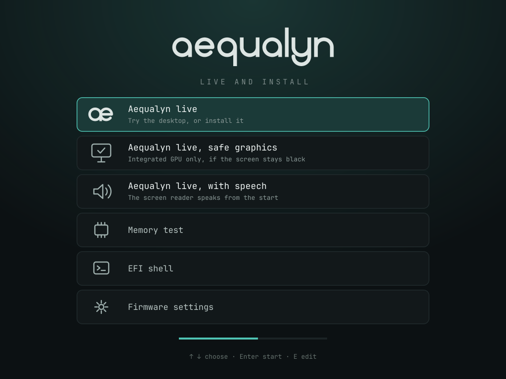

# aequalyn-iso

Builds the Aequalyn live / install ISO with archiso.

```sh
# next to checkouts of aequalyn, aequalyn-shell, aequalyn-installer,
# aequalyn-pkgs and aequalyn-themes:
sudo ./bin/aequalyn-iso-make
sudo ./bin/aequalyn-iso-make --local-source ~/src/aequalyn    # checkouts elsewhere
./bin/aequalyn-iso-build                                       # interactive wrapper: one sudo prompt
./bin/aequalyn-iso-test                                        # boot the newest ISO in QEMU (UEFI)
RAM=8192 CPUS=6 ./bin/aequalyn-iso-test
./bin/aequalyn-sign-iso                                        # interactive menu: GPG-sign the ISO
```

Missing repositories are cloned from github.com/Aequalyn. The build assembles
them into one tree (`work/source`), populates `/etc/skel` with the desktop,
copies the tree to `/opt/aequalyn` for the installer, bundles an offline
package repository and writes the ISO to `release/`.

## The scripts

### `bin/aequalyn-iso-make` — build the ISO (run as root)

```
sudo ./bin/aequalyn-iso-make [--local-source DIR] [-h|--help]
```

* `--local-source DIR` — take the Aequalyn repositories from `DIR`
  (siblings `aequalyn`, `aequalyn-shell`, `aequalyn-installer`, `aequalyn-pkgs`,
  `aequalyn-themes`); missing ones are cloned from `github.com/Aequalyn`.
* `-h`, `--help` — print usage and exit.
* Builds, then (always) writes `release/<iso>.sha256`, and **interactively asks**
  (a terminal is required; non-interactive runs default to *no*):
  1. **split the ISO** into `<2 GiB .00x` raw parts `<iso>.001`, `.002`, `.003`,
     `.004`, … (`split -d -a 3 --numeric-suffixes=1 -b 1900M`; re-assemble with
     `cat …* > iso` / Windows `copy /b`); prints a re-assemble hint;
  2. **push to GitHub Releases** — `gh release create <tag>` and upload the
     parts (or unsplit ISO) + `.sha256`; reads a **tag**; needs `gh` installed
     and authenticated; warns if an unsplit ISO exceeds GitHub's 2 GiB
     per-file release limit.

**Environment variables** (set in the environment; when called through
`aequalyn-iso-build`, they are forwarded):

| Variable | |
| --- | --- |
| `KEEP_WORK=1` | Keep `work/` between builds |
| `SKIP_DOWNLOAD=1` | Reuse the offline repository from the previous build |
| `AEQUALYN_GIT` | Clone base URL (default `https://github.com/Aequalyn`) |
| `AQ_WORK=<dir>` | Build on another disk: the work tree goes in `<dir>/aequalyn-iso-work` (the ISO still lands in `release/`) |
| `AQ_MIN_FREE_GB` | Free space the build checks for before starting (default 32: about 30 GB at its peak) |
| `AQ_MIRRORLIST` | A mirrorlist file to download from (default: a few Arch mirrors; the host's own mirrorlist is never used) |
| `SOURCE_DATE_EPOCH` | Reproducible-build timestamp (ISO label + metadata; default now) |
| `GH_REPO` | Target repository for the release-push prompt (default `Aequalyn/aequalyn-iso`) |

### `bin/aequalyn-iso-build` — interactive wrapper (one sudo prompt)

```
./bin/aequalyn-iso-build [--local-source DIR]
```

* `--local-source DIR` — same as `aequalyn-iso-make`; any other arguments are
  forwarded to `aequalyn-iso-make`.
* On a terminal, offers **1) Build from source** (fresh download from Arch
  mirrors, slow) or **2) Skip download** (reuse `work/` + offline repo, fast;
  notes if an existing offline repo was found). Setting `KEEP_WORK` or
  `SKIP_DOWNLOAD` in the environment takes precedence and skips this menu;
  non-interactive runs default to fresh (`KEEP_WORK=0 SKIP_DOWNLOAD=0`).
* Reads the **sudo password once**, validates it (`sudo -v`), `unset`s it, then
  `exec sudo`s `aequalyn-iso-make`. Because `sudo` `env_reset`s, it forwards
  explicitly: `KEEP_WORK`, `SKIP_DOWNLOAD`, `AEQUALYN_GIT`, `AQ_MIRRORLIST`.
  `AQ_WORK`, `GH_REPO`, `SOURCE_DATE_EPOCH`, etc. in your environment are read
  by `aequalyn-iso-make` after `sudo` only if you preserve them (`sudo -E` or
  the forwarding above; `GH_REPO`/`GPG` keyrings for `gh`/`gpg` must match the
  root user under `sudo`).

### `bin/aequalyn-iso-test` — boot the ISO in QEMU

```
./bin/aequalyn-iso-test [ISO]        # default: newest release/*.iso
RAM=<MiB> CPUS=<n> ./bin/aequalyn-iso-test [ISO]
```

* `[ISO]` — path to an ISO; default newest `release/*.iso`.
* `RAM` — MiB of RAM (default `4096`).
* `CPUS` — vCPU count (default `4`).
* UEFI (**OVMF** `edk2`, `-enable-kvm`, virtio-gpu, virtio-net user, USB
  tablet, GTK window, `-cdrom`, ISO read-only, `-boot d`); needs `qemu-system-x86_64`
  + KVM + `edk2-ovmf` (`sudo pacman -S edk2-ovmf`); OVMF paths are
  `/usr/share/edk2/x64/OVMF_CODE.4m.fd` / `OVMF_VARS.4m.fd`. Close the window
  or Ctrl+C to stop. No flags beyond `[ISO]`; behaviour is via `RAM`/`CPUS`.

### `bin/aequalyn-sign-iso` — interactive menu, GPG-sign an ISO

```
./bin/aequalyn-sign-iso [ISO]        # optional: pick the ISO up front; no root needed for signing
```

* Interactive **menu** (a terminal is required):
  1. **Sign an ISO** — GPG **detached** signature `ISO.sig` (binary, default)
     or `ISO.asc` (ASCII-armored); pick ISO; pick **secret key** (or *GPG
     default key*); immediate `gpg --verify` self-check;
  2. **Verify an ISO signature** — `gpg --verify SIG ISO` (auto-guesses
     `.sig`/`.asc`);
  3. **Create a new signing key** — `ed25519` (default) or `RSA-4096`,
     `gpg --quick-generate-key "Name <email>" … sign 2y`;
  4. **List secret keys**;
  5. **Export public key** — ASCII-armored `aequalyn-release.asc`;
  6. **Generate SHA-256 checksum** — portable `ISO.sha256`
     (`sha256sum -c`, just the basename);
  q. **Quit**.
* Separate step from `aequalyn-iso-make`. Uses the **current user's** GPG
  keyring (`$GNUPGHOME` or `~/.gnupg`). A signature proves authenticity +
  integrity of the whole ISO; verify on the re-assembled ISO, **not** on split
  `.00x` parts; `.sha256` is integrity-only. `mkarchiso -g/-G` (rootfs signing
  inside the ISO) is separate and is **not** done by this script.
* **Note:** `aequalyn-iso-make` builds as root, so `release/` and the ISO are
  root-owned; run this as the same user who holds the key, or `sudo`, or
  `sudo chown`. Needs `gpg`. Nothing in `aequalyn-iso-make` is changed.

SDDM owns the boot login: it autologs `live` into the `aequalyn` Wayland
session, which starts a single guarded Hyprland + QuickShell desktop. A root
rescue shell stays on tty2 (`Ctrl+Alt+F2`). Run `sudo aequalyn-install`
(or `Super + I`) to install.

The boot menu wears the Aequalyn look, on UEFI (GRUB, `boot/grub-theme/`) and BIOS
(syslinux, `boot/syslinux/`): the mark, the live desktop, safe graphics, speech, the installed
system, memory test, EFI shell, firmware settings, restart and power off, as far as the
machine has them. `boot/make-theme.py` draws its pictures.



**Aequalyn live, safe graphics**, under the default entry, keeps the discrete GPU's drivers (nouveau, nvidia) from
loading, so the integrated GPU drives the screen. Use it on laptops with hybrid
graphics, or when a graphics card does not start the desktop.

Packages not in the Arch repositories (aequalyn-pkgs `local.packages`: mpvpaper,
DDWriter, nudu) are installed on the live system from a local repository made
from aequalyn-pkgs `aur-cache/`.

## Live session defaults

- The `live` user's password is **`live`**. Autologin means you normally never
  type it to reach the desktop, but it is needed to unlock the screen
  (hyprlock) or log in manually. `sudo` stays passwordless for `live` since the
  medium is ephemeral.
- **root** has the same password, **`live`** (set in `overlay/airootfs/etc/shadow`),
  so the tty2 root rescue shell and any `su -` from the live session work
  without a puzzle. Nothing in the installed system keeps this: the target's
  root password is whatever the installer's password field sets.
- The display scale is fixed at **1** — no HiDPI auto-detection. The live
  session's Hyprland config uses `scale = 1` instead of `scale = "auto"`;
  because that setting comes from the core `aequalyn` config, newly installed
  systems default to scale 1 as well. On the live image `monitors.lua` is empty,
  so nothing overrides it.

## Credits

[nightdevil00](https://github.com/nightdevil00) contributed to the code here.

## Documentation

- `SECURITY.md` — security model and concerns.
- `SKILL.md` — development/install skill reference.
